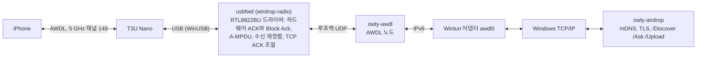

# WirDrop

Windows 11용 AirDrop입니다. 파일 탐색기에서 iPhone이나 iPad로 파일을 보내고, iPhone 공유 시트에서
이 PC로 받습니다. 따로 여는 창은 없습니다: 트레이 아이콘, 탐색기 메뉴의 AirDrop 항목, 화면
가장자리에 뜨는 Dynamic Island 모양의 카드가 전부입니다. AirDrop이 쓰는 무선 링크(AWDL)를 USB 무선
랜카드로 사용자 모드에서 WinUSB를 거쳐 직접 구동하므로 커널 드라이버를 설치하지 않고, Secure Boot를
켠 채로 씁니다.

[English](README.md)

> WirDrop은 Apple과 관계가 없습니다. AirDrop은 Apple Inc.의 상표입니다. iOS/macOS용 USB 전송 앱인
> WireDrop과도 관계가 없습니다.

**상태: 실험 단계.** 지원하고 시험한 어댑터는 TP-Link Archer T3U Nano(Realtek RTL8812BU, USB
`2357:012E`) 하나이며, 최신 iPhone, iPad와 시험했습니다.

## 하는 일

- **받기**: iPhone이나 iPad의 공유 시트에 이 PC가 보입니다. 내 기기와 항상 수락으로 정한 사람은
  바로 받고, 그 밖의 사람은 아일랜드에서 묻습니다.
- **보내기**: 탐색기에서 파일이나 폴더를 우클릭해 AirDrop을 고르면 마우스 자리에 기기 메뉴가
  열립니다. 기기는 찾는 대로 나타났다 사라집니다.
- **누가 보낼 수 있는지**: iPhone처럼 받지 않음, 연락처만, 모든 사람. "연락처만"과 "내 기기"에는
  Apple ID 로그인(선택)이 필요하고, Mac처럼 아일랜드에서 로그인합니다.
- **아일랜드**: 질문, 진행, 결과를 보여 주는 검은 카드로, 화면 가장자리(또는 모서리, 가운데)에서
  흘러나옵니다. 떠 있는 동안 **Win+Alt+A**를 누르면 키보드로 버튼을 고를 수 있습니다 (Tab이나
  화살표로 고르고, Enter나 Space로 누르고, Esc로 원래 창에 돌려줌). 화면 읽기 프로그램은 UI
  Automation으로 읽습니다.
- **업데이트**는 보내거나 받는 중이 아닐 때 스스로 설치하며, 무엇이든 바꾸기 전에 서명을
  확인합니다.

## 설치

1. [Releases](https://github.com/JungyoKim/WirDrop/releases)에서 `WirDrop-Setup-<버전>.exe`를 받아
   실행합니다. 관리자 권한을 한 번 묻고, 엔진 서비스를 설치하고, 어댑터를 Windows 자체 WinUSB
   드라이버에 묶고, 탐색기 메뉴를 등록합니다. 아직 코드 서명이 없어 SmartScreen이 먼저 경고할 수
   있습니다.
2. TP-Link Archer T3U Nano를 꽂습니다. WirDrop이 쓰는 동안은 일반 무선 랜카드로 쓰이지 않으니
   인터넷은 평소 Wi-Fi로 하세요. WirDrop을 제거하면 어댑터를 Windows에 돌려줍니다.
3. 보내려면 Bluetooth를 켜 두세요: Bluetooth LE로 주변 iPhone을 깨웁니다.

필요한 것: Windows 11 x64, 위의 어댑터, Bluetooth.

## 속도

1 m 거리의 iPhone과 79.75 MB 영상:

| 방향 | WirDrop | 처음 동작한 버전 |
|---|---|---|
| iPhone → PC | 3.1~3.6초 (22~26 MB/s) | 22초 |
| PC → iPhone | iPhone 수락 후 3.1~3.3초 (24~26 MB/s) | 14.1초 |

Mac은 같은 영상을 약 7초에 받습니다. 지금 한계는 iPhone 쪽에 있습니다: 전송 시간의 65~77%만 우리
채널에 머뭅니다.

## 구조



- `usbfwd`(`crates/radio`): WirDrop의 사용자 모드 RTL8822BU/RTL8812BU 드라이버 wirdrop-radio로
  어댑터를 구동합니다. WinUSB를 직접 쓰고, 칩 초기화는 Linux
  [rtw88](https://github.com/torvalds/linux/tree/master/drivers/net/wireless/realtek/rtw88)에서
  BSD-3-Clause로 옮겼으며 Realtek의 재배포 가능 펌웨어를 씁니다.
- `wirdrop`(`crates/wirdrop`): [owly](https://github.com/t4t5/owly)의 AWDL 노드를 그 무선과
  [Wintun](https://www.wintun.net) 어댑터 사이에서 돌리고, 그 IPv6 링크 위에서 owly의 AirDrop
  보내기·받기를 돌립니다.
- `WirDrop.exe`(`crates/app`): 트레이 앱, 엔진(`WirDropEngine` 서비스가 돌리므로 매번 UAC가
  뜨지 않음), 업데이트.

## Apple ID (선택)

없으면 iPhone은 "모든 사람(10분)" 모드에서만 PC를 봅니다. 트레이 메뉴의 Apple ID에서 로그인하면 Mac과
같은 방식으로 AirDrop 신원을 받습니다: 암호로 Apple에 로그인하고, 계정이 요구하면 확인 코드를 넣은
뒤, aidc.apple.com에서 AirDrop 인증서를 받고 연락처 확인용 iCloud 연락처 해시를 만듭니다. 암호는
저장하지 않습니다. 로그인으로 생긴 세션이 인증서와 기록을 만료 전에 갱신하며, 이 세션은 Windows
사용자용으로 보호(DPAPI)해 둡니다. Apple 서버가 요구하는 기기 보증은 iCloud for Windows의 AOSKit이
만듭니다. 첫 로그인 때 Apple에서 받아(약 160 MB) 설치하지 않고 풀어서 씁니다.

PC를 같이 쓰는 사람마다 Apple ID를 하나씩 더할 수 있습니다 (Mac에서 사용자마다 Apple ID가 있는 것과
같습니다). 어느 폰에도 PC는 한 번만 보입니다: 주인의 기기에는 내 기기로, 그 밖의 사람에게는
이름으로.

## 빌드

Rust 1.95 이상. 배치에는 Windows SDK(`makeappx`), i686 타깃(`rustup target add
i686-pc-windows-msvc`, 32비트 `appleid-anisette.exe`용), `wintun.dll`(amd64,
[wintun.net](https://www.wintun.net))이 필요합니다.

```powershell
git clone https://github.com/JungyoKim/WirDrop
cd WirDrop
cargo build --release
./packaging/stage.ps1 -Out D:\WirDrop -Wintun C:\path\to\wintun.dll   # WirDrop이 도는 폴더 전체
```

설치 프로그램은 `packaging/installer/WirDrop.iss`(Inno Setup 6)입니다. `v*` 태그를 올리면 GitHub
Actions(`.github/workflows/release.yml`)가 릴리스를 만듭니다: 설치 프로그램, 서명한
`update.json`과 업데이트 zip, winget 매니페스트.

라이브러리만 쓰려면 관리자 터미널에서:

```powershell
cargo build --release -p wirdrop --example wirdrop-cli
cargo build --release -p wirdrop-radio --bin usbfwd
# usbfwd.exe와 wintun.dll을 wirdrop-cli.exe 옆에 두고:
wirdrop-cli receive --name "내 PC" --save "$env:USERPROFILE\Downloads\AirDrop" --accept-all
wirdrop-cli send .\photo.jpg --to iPhone
```

## 점검

- `cargo clippy --workspace --all-targets`와 `cargo test --workspace` (CI가 둘 다, 그리고
  `vendor/`의 owly 테스트도 돌립니다).
- `scripts/check-transfer.ps1`: 루프백 전송 테스트(한글 이름, 폴더, 거절, 256 MB 속도)와 엔진
  로그의 실제 전송 기록을, 내 PC에 저장한 기준선(`-SaveBaseline`)과 견줍니다.

## 저장소

| 경로 | 내용 | 라이선스 |
|---|---|---|
| `crates/wirdrop` | 라이브러리(AWDL 링크, AirDrop)와 `examples/wirdrop-cli.rs` | MIT |
| `crates/radio` | 어댑터 드라이버 wirdrop-radio와 `usbfwd` | MIT, rtw88의 BSD-3-Clause 코드 포함 ([NOTICE](crates/radio/NOTICE.md)) |
| `crates/app` | `WirDrop.exe`: 트레이 앱, 엔진, 서비스, 업데이트 | MIT |
| `crates/island` | 아일랜드 (Windows.UI.Composition, Direct2D) | MIT; `assets/`의 Pretendard(OFL), Framework7 Icons(MIT) |
| `crates/menu`, `crates/shell` | WinUI 3 트레이 메뉴와 탐색기 메뉴 DLL | MIT |
| `crates/appleid`, `crates/appleid-anisette` | Apple ID 로그인과 32비트 anisette 도우미 | MIT |
| `vendor/owly-awdl`, `vendor/owly-airdrop` | owly (바꾼 내용은 각 README에) | MIT |
| `packaging` | 배치, 설치 프로그램, 탐색기 메뉴 패키지, winget 매니페스트 | MIT |
| `scripts` | 개발용 점검 | MIT |

GPL이나 MPL이 적용되는 부분은 없습니다. `usbfwd.exe`에는 Realtek의 RTL8822B 펌웨어
(`crates/radio/firmware`, 자체 라이선스로 수정 없이 재배포 가능)가 들어 있고, `stage.ps1`이
`crates/radio/NOTICE.md`와 그 라이선스를 함께 넣습니다. iCloud for Windows는 배포물에 넣지 않고
`appleid.exe`가 PC에서 Apple로부터 받습니다.

## 알려진 한계

- 어댑터 한 모델, 5 GHz 채널 149.
- 속도는 iPhone이 채널 149에 머무는 시간에 달려 있고, 그것은 iPhone이 정합니다.
- 가끔 iPhone 공유 시트를 다시 열어야 PC가 보입니다.

## 감사

[owly](https://github.com/t4t5/owly)(t4t5), [omdrop-windows](https://github.com/ZyphrZero/omdrop-windows)
(`vendor/`의 Windows용 owly 수정의 출발점), Linux rtw88(Realtek, wirdrop-radio의 출발점),
[devourer](https://github.com/OpenIPC/devourer)(OpenIPC, 사용자 모드 Realtek 드라이버가 가능함을 보여 줌),
[Wintun](https://www.wintun.net)(WireGuard), [TranslucentTB](https://github.com/TranslucentTB/TranslucentTB)
(WinUI 트레이 메뉴의 본보기), 그리고 AWDL과 AirDrop을 분석한 [Open Wireless Link](https://owlink.org)
프로젝트(TU Darmstadt SEEMOO). `appleid`는 AltServer, SideStore, pypush 등이 공개한 Apple
GrandSlam 로그인과 anisette 분석을 바탕으로 새로 작성했습니다.

## 라이선스

MIT([LICENSE](LICENSE)). `crates/radio`에는 rtw88에서 옮긴 BSD-3-Clause 코드와 Realtek 펌웨어(자체
라이선스)가 들어 있습니다. [crates/radio/NOTICE.md](crates/radio/NOTICE.md)를 보세요.
