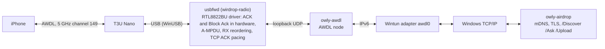

# WirDrop

AirDrop for Windows 11. Send files from File Explorer to an iPhone or iPad, and receive from an
iPhone's share sheet, with no window to open: a tray icon, an AirDrop entry in Explorer's menu,
and a Dynamic Island-style card at the edge of the screen. WirDrop drives AirDrop's Wi-Fi link
(AWDL) on a USB Wi-Fi adapter from user mode over WinUSB, so it installs no kernel driver and
Secure Boot stays on.

[한국어](README.ko.md)

> WirDrop is not affiliated with or endorsed by Apple. AirDrop is a trademark of Apple Inc. It is
> unrelated to WireDrop, the iOS/macOS USB transfer app.

**Status: experimental.** One adapter is supported and tested: the TP-Link Archer T3U Nano
(Realtek RTL8812BU, USB `2357:012E`), with current iPhones and iPads.

## What it does

- **Receive** from an iPhone or iPad: it shows this PC in its share sheet. Your own devices and
  people you chose are accepted at once; anyone else is asked on the island.
- **Send** from Explorer: right-click files or a folder, choose AirDrop, and pick a device from
  the menu that opens at the pointer. Devices come and go in it as they're found.
- **Who can send**: no one, contacts only, or everyone, as on an iPhone. Contacts only and
  "this is my device" need an Apple ID sign-in (optional), done on the island like a Mac does it.
- **The island**: a black card that pours out of the screen edge (or a corner, or the middle)
  for questions, progress and results. Press **Win+Alt+A** while it's up to reach its buttons
  from the keyboard (Tab or arrows to choose, Enter or Space to press, Esc to give the keyboard
  back). Screen readers read it through UI Automation.
- **Updates** install themselves while nothing is being sent or received, checked against a
  signature before anything is replaced.

## Install

1. Download `WirDrop-Setup-<version>.exe` from [Releases](https://github.com/JungyoKim/WirDrop/releases)
   and run it. It asks for administrator rights once: it installs the engine service, puts the
   adapter on Windows' own WinUSB driver, and registers the Explorer menu. The builds aren't
   code-signed yet, so SmartScreen may warn first.
2. Plug in the TP-Link Archer T3U Nano. It stops being an ordinary Wi-Fi card while WirDrop uses
   it; keep your normal Wi-Fi for the internet. Uninstalling WirDrop gives it back to Windows.
3. Keep Bluetooth on for sending: WirDrop wakes nearby iPhones over Bluetooth LE.

Requirements: Windows 11 x64, the adapter above, Bluetooth.

## Speed

A 79.75 MB video between the PC and an iPhone a metre away:

| Direction | WirDrop | First working version |
|---|---|---|
| iPhone → PC | 3.1-3.6 s (22-26 MB/s) | 22 s |
| PC → iPhone | 3.1-3.3 s after the iPhone accepts (24-26 MB/s) | 14.1 s |

A Mac receives the same video in about 7 s. What limits it now is the iPhone, which spends only
65-77% of a transfer on our channel.

## How it works



- `usbfwd` (in `crates/radio`) drives the adapter with wirdrop-radio, WirDrop's user-mode
  RTL8822BU/RTL8812BU driver. It talks to WinUSB directly; the chip bring-up is ported from Linux
  [rtw88](https://github.com/torvalds/linux/tree/master/drivers/net/wireless/realtek/rtw88)
  under its BSD-3-Clause license, with Realtek's redistributable firmware.
- `wirdrop` (`crates/wirdrop`) runs [owly](https://github.com/t4t5/owly)'s AWDL node between
  that radio and a [Wintun](https://www.wintun.net) adapter, and owly's AirDrop sender and
  receiver over the resulting IPv6 link.
- `WirDrop.exe` (`crates/app`) is the tray app, the engine (run by the `WirDropEngine`
  service, so there's no UAC prompt each time) and the updater.

## Apple ID (optional)

Without one, iPhones see the PC only in "Everyone for 10 Minutes" mode. Signing in from the tray
menu (Apple ID, then sign in) gets an AirDrop identity the way a Mac does: Apple's sign-in with
the password and, if asked, a verification code; then the AirDrop certificate from
aidc.apple.com and hashes of your iCloud contacts for the contact check. The password isn't
kept; the session the sign-in leaves renews the certificate and record before they run out, and
is stored protected for your Windows user (DPAPI). Apple's servers want each request vouched for
by the machine; iCloud for Windows' own AOSKit does that, downloaded from Apple at the first
sign-in (about 160 MB) and unpacked, not installed.

Several people sharing the PC can each add an Apple ID, as each user on a Mac has one. Every
phone lists the PC once: as one of its own devices for its owner, by name for anyone else.

## Build

Rust 1.95 or newer; for staging, the Windows SDK (`makeappx`), the i686 target
(`rustup target add i686-pc-windows-msvc`, for the 32-bit `appleid-anisette.exe`) and
`wintun.dll` (amd64, from [wintun.net](https://www.wintun.net)).

```powershell
git clone https://github.com/JungyoKim/WirDrop
cd WirDrop
cargo build --release
./packaging/stage.ps1 -Out D:\WirDrop -Wintun C:\path\to\wintun.dll   # everything WirDrop runs from
```

The setup program is `packaging/installer/WirDrop.iss` (Inno Setup 6). A `v*` tag builds a
release on GitHub Actions (`.github/workflows/release.yml`): the setup program, the update zip
with its signed `update.json`, and the winget manifests.

The library on its own, from an administrator terminal:

```powershell
cargo build --release -p wirdrop --example wirdrop-cli
cargo build --release -p wirdrop-radio --bin usbfwd
# usbfwd.exe and wintun.dll beside wirdrop-cli.exe, then:
wirdrop-cli receive --name "My PC" --save "$env:USERPROFILE\Downloads\AirDrop" --accept-all
wirdrop-cli send .\photo.jpg --to iPhone
```

## Checks

- `cargo clippy --workspace --all-targets` and `cargo test --workspace` (CI runs both, and
  owly's tests in `vendor/`).
- `scripts/check-transfer.ps1`: a loopback transfer test (Korean names, folders, a declined
  request, and a 256 MB speed run) plus the real transfers in the engine's log, compared with a
  baseline you save on your PC (`-SaveBaseline`).

## Repository

| Path | What | License |
|---|---|---|
| `crates/wirdrop` | the library (AWDL link, AirDrop), and `examples/wirdrop-cli.rs` | MIT |
| `crates/radio` | wirdrop-radio, the adapter driver, and `usbfwd` | MIT, with BSD-3-Clause code from rtw88 ([NOTICE](crates/radio/NOTICE.md)) |
| `crates/app` | `WirDrop.exe`: tray app, engine, service, updater | MIT |
| `crates/island` | the island (Windows.UI.Composition, Direct2D) | MIT; Pretendard (OFL) and Framework7 Icons (MIT) in `assets/` |
| `crates/menu`, `crates/shell` | the WinUI 3 tray menu, and the Explorer menu's DLL | MIT |
| `crates/appleid`, `crates/appleid-anisette` | the Apple ID sign-in and its 32-bit anisette helper | MIT |
| `vendor/owly-awdl`, `vendor/owly-airdrop` | owly, with the changes listed in their READMEs | MIT |
| `packaging` | staging, the installer, the Explorer menu package, winget manifests | MIT |
| `scripts` | development checks | MIT |

No part of WirDrop is under the GPL or the MPL. `usbfwd.exe` embeds Realtek's RTL8822B firmware
(`crates/radio/firmware`), redistributable unmodified under Realtek's license; `stage.ps1`
ships `crates/radio/NOTICE.md` and that license with it. iCloud for Windows is not shipped:
`appleid.exe` downloads it from Apple on the PC.

## Known limits

- One adapter model, on 5 GHz channel 149.
- Speed depends on how long the iPhone stays on channel 149, which the iPhone decides.
- The PC sometimes needs the iPhone's share sheet reopened before it appears.

## Acknowledgements

- [owly](https://github.com/t4t5/owly) by t4t5: the AWDL and AirDrop protocol implementation.
- [omdrop-windows](https://github.com/ZyphrZero/omdrop-windows): the Windows changes to owly
  carried in `vendor/` started from its copy.
- Linux [rtw88](https://github.com/torvalds/linux/tree/master/drivers/net/wireless/realtek/rtw88)
  by Realtek: the chip bring-up wirdrop-radio is ported from.
- [devourer](https://github.com/OpenIPC/devourer) by OpenIPC: the user-mode Realtek driver that
  showed this could work.
- [Wintun](https://www.wintun.net) by WireGuard; [TranslucentTB](https://github.com/TranslucentTB/TranslucentTB),
  whose tray menu the WinUI menu follows.
- The public reverse engineering of Apple's GrandSlam sign-in and anisette (AltServer, SideStore,
  pypush and others), which `appleid` implements anew.
- The [Open Wireless Link](https://owlink.org) project (TU Darmstadt SEEMOO), whose reverse
  engineering of AWDL and AirDrop this all builds on.

## License

MIT (see [LICENSE](LICENSE)). `crates/radio` also carries code ported from rtw88 under the
BSD-3-Clause license and Realtek's firmware under its own license; see
[crates/radio/NOTICE.md](crates/radio/NOTICE.md).
