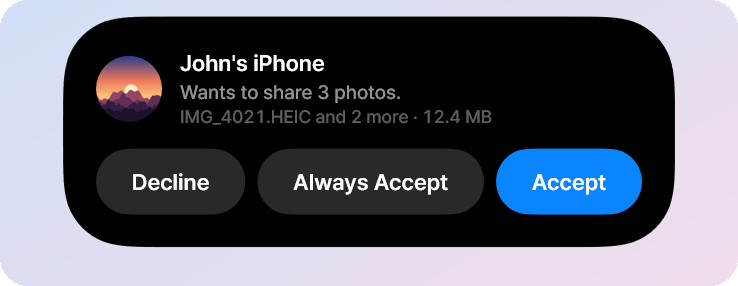
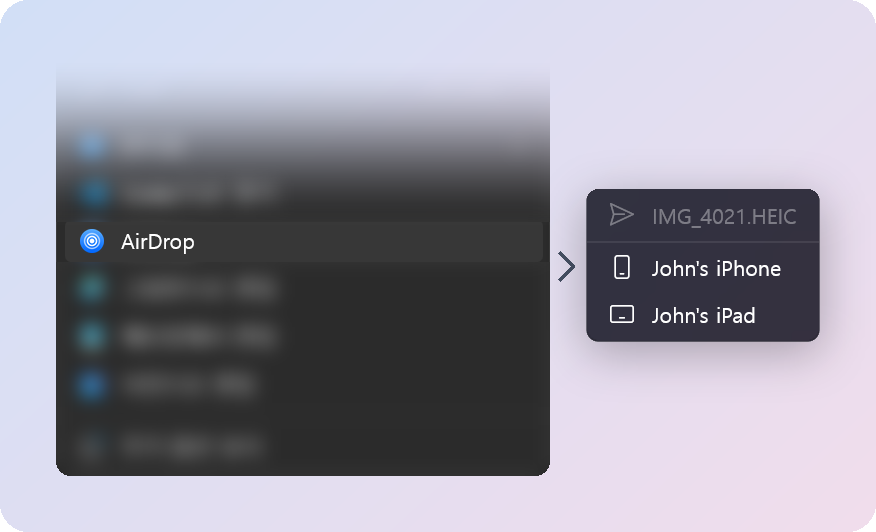
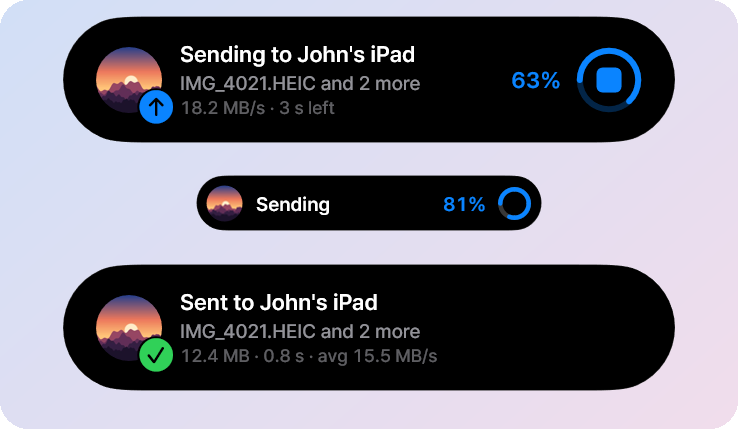
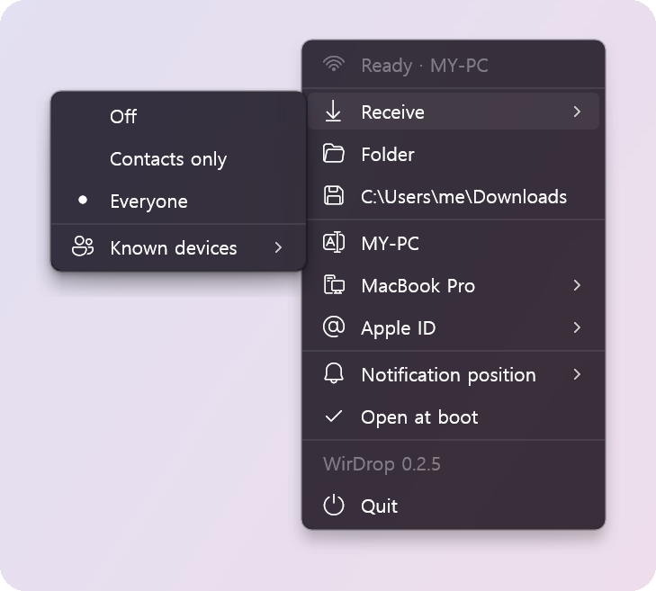
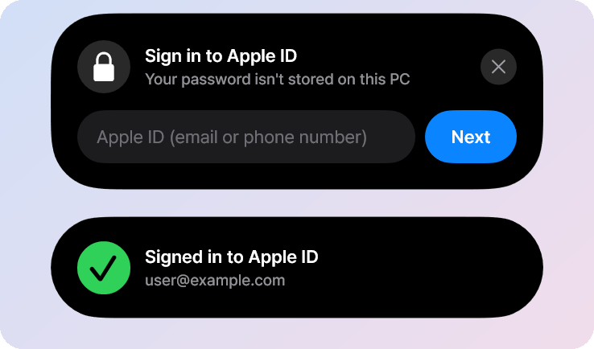

### AirDrop for Windows 11

Send files from File Explorer to an iPhone or iPad, and receive them from the iPhone's share sheet. 
No window to open: a tray icon, the right-click menu, and a Dynamic Island at the edge of the screen.

**English** · [한국어](readme/README.ko.md)

<table>
<tr>
<td width="40%">
<h3>Receive in one click</h3>
When an iPhone shares with this PC, a card pours out of the screen edge. Your own devices and the
people you trust go straight through. What arrives lands on the clipboard too, so Ctrl+V pastes it
into a chat or a document.
</td>
<td></td>
</tr>
<tr>
<td>
<h3>Send from File Explorer</h3>
Right-click files or a folder, choose <b>AirDrop</b>, and pick an iPhone or iPad. Devices come and
go in the list as they're found.
</td>
<td></td>
</tr>
<tr>
<td>
<h3>Watch it go</h3>
Speed and time left while it runs, shrinking to a small pill so it stays out of the way. The stop
button cancels it.
</td>
<td></td>
</tr>
<tr>
<td>
<h3>Everything in one menu</h3>
Who can send to you, where files go, how this PC looks on an iPhone, and where the island appears.
All from the tray icon.
</td>
<td></td>
</tr>
<tr>
<td>
<h3>Your Apple ID, if you like</h3>
Sign in on the island and this PC shows up as one of your own devices, with Contacts Only like a
Mac. Optional, and your password is never stored.
</td>
<td></td>
</tr>
</table>

## What you need

- A Windows 11 PC (64-bit) with Bluetooth
- A USB Wi-Fi adapter: an **ipTIME BE6500UA** or a **TP-Link Archer T3U Nano**. It becomes
  WirDrop's AirDrop radio while it's plugged in, so your usual Wi-Fi keeps the internet. You don't
  need the adapter's own driver.
- An iPhone or iPad with AirDrop

## Get started

1. Download **WirDrop-Setup** from [Releases](https://github.com/JungyoKim/WirDrop/releases/latest)
   and run it. It asks for administrator permission once. The app isn't code-signed yet, so
   SmartScreen may warn you first: choose **More info**, then **Run anyway**.
2. Plug in the adapter. The tray icon turns blue when WirDrop is ready.
3. On the iPhone, tap **Share**, then **AirDrop**, and pick this PC. To send the other way,
   right-click a file on the PC and choose **AirDrop**.

Updates install themselves when nothing is being sent or received. The tray menu shows the version
it's running, and the new one while it installs.

<b>Why does it need a USB adapter?</b>

AirDrop runs over AWDL, Apple's own Wi-Fi link, which Windows Wi-Fi drivers can't speak. WirDrop
drives the adapter itself, from an ordinary app over Windows' built-in WinUSB driver. No kernel
driver is installed and Secure Boot stays on. Uninstalling WirDrop gives the adapter back to
Windows.

<b>How fast is it?</b>

With the iPhone a metre away, the BE6500UA talks Wi-Fi 6 both ways and moves a 1.26 GB video to
the PC in about 32 seconds (40 MB/s) and back in about 27 seconds (47 MB/s). The T3U Nano sends
an 80 MB video in about 3 seconds either way (22 to 26 MB/s). See
[How it works](docs/how-it-works.md#speed).

<b>Is it safe to sign in with my Apple ID?</b>

WirDrop signs in the way a Mac does and keeps only the session that renews its AirDrop
certificate, protected for your Windows account. The password is never stored. Signing in is
optional: without it, iPhones see the PC when they're set to Everyone. See
[Apple ID](docs/how-it-works.md#apple-id).

<b>Can I use it with the keyboard or a screen reader?</b>

Press **Win+Alt+A** while the island is showing to move to its buttons: Tab or the arrow keys to
choose, Enter or Space to press, Esc to go back. Screen readers read the island through UI
Automation.

<b>Can several people share the PC?</b>

Yes. Each person can add their own Apple ID, as each user on a Mac has one. Every phone lists the
PC once: as one of its own devices for its owner, by name for everyone else.

## Learn more

- [All screens](docs/screens.md): every card and menu WirDrop shows
- [How it works](docs/how-it-works.md): the AirDrop link, Apple ID sign-in, speed and limits
- [Building WirDrop](docs/building.md): building from source, releases, checks and licenses

> WirDrop is not affiliated with or endorsed by Apple. AirDrop is a trademark of Apple Inc.
> WirDrop is experimental and unrelated to WireDrop, the iOS and macOS USB transfer app.

## Thanks

[owly](https://github.com/t4t5/owly) by t4t5 implements AWDL and AirDrop, and
[omdrop-windows](https://github.com/ZyphrZero/omdrop-windows) first ported it to Windows. The radio
driver is ported from Linux [rtw88](https://github.com/torvalds/linux/tree/master/drivers/net/wireless/realtek/rtw88),
and OpenIPC's [devourer](https://github.com/OpenIPC/devourer) showed that a user-mode Realtek
driver could work. [Wintun](https://www.wintun.net) carries the network, and
[TranslucentTB](https://github.com/TranslucentTB/TranslucentTB)'s tray menu is the model for
WirDrop's. All of it builds on the [Open Wireless Link](https://owlink.org) project's reverse
engineering of AWDL and AirDrop, and the Apple ID sign-in follows public work by AltServer,
SideStore and pypush.

## License

MIT, see [LICENSE](LICENSE). The radio driver also carries BSD-3-Clause code from rtw88 and
Realtek's firmware under its own license; see [crates/radio/NOTICE.md](crates/radio/NOTICE.md).
