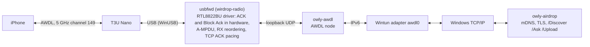

# How WirDrop works

[← Back to the README](../README.md) · [한국어](ko/how-it-works.md)

AirDrop has two layers. Underneath is AWDL (Apple Wireless Direct Link), a Wi-Fi link that Apple
devices set up between themselves, hopping between their normal channel and a shared one. On top
of it run Bluetooth LE advertisements to wake nearby devices, mDNS to find them, and HTTPS (TLS
with each device's Apple-issued certificate) to ask and send. Windows Wi-Fi drivers can't do
AWDL, so WirDrop brings its own radio.

## The pieces

- **usbfwd** (`crates/radio`) drives the TP-Link Archer T3U Nano (Realtek RTL8812BU, USB
  `2357:012E`) with wirdrop-radio, WirDrop's user-mode RTL8822BU/RTL8812BU driver. It talks to
  Windows' built-in WinUSB driver, so nothing runs in the kernel and Secure Boot stays on. The chip
  bring-up is ported from Linux [rtw88](https://github.com/torvalds/linux/tree/master/drivers/net/wireless/realtek/rtw88)
  under its BSD-3-Clause license, with Realtek's redistributable firmware.
- **wirdrop** (`crates/wirdrop`) runs [owly](https://github.com/t4t5/owly)'s AWDL node between that
  radio and a [Wintun](https://www.wintun.net) adapter named awdl0, and owly's AirDrop sender and
  receiver over the resulting IPv6 link.
- **WirDrop.exe** (`crates/app`) is the tray app, the engine and the updater. The engine runs in
  the WirDropEngine service, so there's no administrator prompt each time it starts.
- **The island** (`crates/island`) draws its cards with Windows.UI.Composition and Direct2D: the
  outline is a compositor animation and the content is redrawn only when it changes, so it costs
  almost nothing while it moves. Text is Pretendard and icons are Framework7 Icons.
- **The menus** (`crates/menu`, `crates/shell`) are WinUI 3 menus for the tray icon and the device
  list, and the DLL behind the AirDrop entry in File Explorer's menu.

## Apple ID

Without an Apple ID, iPhones see the PC only while they're set to receive from Everyone for 10
minutes. Signing in from the tray menu (Apple ID, then Sign in with Apple ID) gets an AirDrop
identity the way a Mac does:

1. Apple's sign-in with the password and, if the account asks, a verification code.
2. The AirDrop certificate from Apple (aidc.apple.com).
3. Hashes of your iCloud contacts, so iPhones can check that you know each other.

The password is never stored. The session the sign-in leaves renews the certificate and its record
before they run out, and is kept protected for your Windows account (DPAPI). Apple's servers want
each request vouched for by the machine; iCloud for Windows' own component does that. WirDrop
downloads it from Apple at the first sign-in (about 160 MB) and unpacks it without installing
iCloud.

Several people sharing the PC can each add an Apple ID, as each user on a Mac has one. Every phone
lists the PC once: as one of its own devices for its owner, by name for everyone else.

## Speed

An 80 MB (79.75 MB) video between the PC and an iPhone a metre away:

| Direction | WirDrop | First working version |
|---|---|---|
| iPhone → PC | 3.1 to 3.6 s (22 to 26 MB/s) | 22 s |
| PC → iPhone | 3.1 to 3.3 s after the iPhone accepts (24 to 26 MB/s) | 14.1 s |

What limits it now is the iPhone, which spends only 65 to 77% of a transfer on the shared channel.

## Known limits

- One adapter model, on 5 GHz channel 149.
- Speed depends on how long the iPhone stays on channel 149, which the iPhone decides.
- Sometimes the iPhone's share sheet needs reopening before the PC appears.
