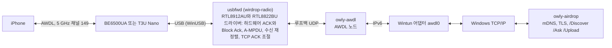

# WirDrop의 동작 원리

[← README로 돌아가기](../../readme/README.ko.md) · [English](../how-it-works.md)

AirDrop은 두 층으로 되어 있습니다. 아래에는 Apple 기기끼리 맺는 Wi-Fi 링크인 AWDL(Apple Wireless
Direct Link)이 있어, 기기들이 원래 채널과 공용 채널을 오갑니다. 그 위에서 Bluetooth LE 광고로 주변
기기를 깨우고, mDNS로 찾고, HTTPS(기기마다 Apple이 발급한 인증서를 쓰는 TLS)로 묻고 보냅니다.
Windows의 Wi-Fi 드라이버는 AWDL을 할 수 없어서 WirDrop은 자체 무선을 씁니다.

## 구성

- **usbfwd**(`crates/radio`)는 WirDrop의 사용자 모드 드라이버 wirdrop-radio로 랜카드를 다룹니다.
  Realtek 칩 두 가지를 지원합니다: ipTIME BE6500UA의 RTL8912AU(USB `0BDA:8912`)와 TP-Link
  Archer T3U Nano의 RTL8812BU(USB `2357:012E`). Windows 내장 WinUSB 드라이버와 이야기하므로
  커널에서 도는 것이 없고 Secure Boot도 켠 채로 씁니다. 칩 초기화는 Linux
  [rtw89](https://github.com/torvalds/linux/tree/master/drivers/net/wireless/realtek/rtw89)와
  [rtw88](https://github.com/torvalds/linux/tree/master/drivers/net/wireless/realtek/rtw88)에서
  BSD-3-Clause로 옮겼고, Realtek의 재배포 가능한 펌웨어를 씁니다. BE6500UA는 꽂으면 먼저 Realtek
  Windows 드라이버가 든 가상 CD로 나타나는데, WirDrop이 이를 꺼내 무선 랜카드로 다시 잡히게 합니다.
  두 랜카드가 모두 꽂혀 있으면 BE6500UA를 씁니다.
- **wirdrop**(`crates/wirdrop`)은 [owly](https://github.com/t4t5/owly)의 AWDL 노드를 그 무선과
  awdl0이라는 [Wintun](https://www.wintun.net) 어댑터 사이에서 돌리고, 그렇게 생긴 IPv6 링크
  위에서 owly의 AirDrop 보내기와 받기를 돌립니다.
- **WirDrop.exe**(`crates/app`)는 트레이 앱, 엔진, 업데이트를 맡습니다. 엔진은 WirDropEngine
  서비스에서 돌기 때문에 시작할 때마다 관리자 권한을 묻지 않습니다.
- **아일랜드**(`crates/island`)는 Windows.UI.Composition과 Direct2D로 카드를 그립니다. 윤곽은
  합성기의 애니메이션이고 내용은 바뀔 때만 다시 그리므로, 움직이는 동안에도 거의 자원을 쓰지
  않습니다. 글꼴은 Pretendard, 아이콘은 Framework7 Icons입니다.
- **메뉴**(`crates/menu`, `crates/shell`)는 트레이 아이콘과 기기 목록의 WinUI 3 메뉴, 그리고
  파일 탐색기 메뉴의 AirDrop 항목 뒤에 있는 DLL입니다.

## Apple ID

Apple ID가 없으면 iPhone은 모든 사람(10분)으로 받기일 때만 PC를 봅니다. 트레이 메뉴의 Apple ID에서
Apple ID로 로그인하면 Mac과 같은 방식으로 AirDrop 신원을 받습니다.

1. 암호로 Apple에 로그인하고, 계정이 요구하면 확인 코드를 넣습니다.
2. Apple(aidc.apple.com)에서 AirDrop 인증서를 받습니다.
3. iPhone이 서로 아는 사이인지 확인할 수 있도록 iCloud 연락처의 해시를 만듭니다.

암호는 저장하지 않습니다. 로그인으로 생긴 세션이 인증서와 그 기록을 만료 전에 갱신하며, 이 세션은
Windows 계정용으로 보호(DPAPI)해 둡니다. Apple 서버는 요청마다 기기의 보증을 요구하는데, 이것은
iCloud for Windows의 구성 요소가 만듭니다. WirDrop은 첫 로그인 때 이를 Apple에서 받아(약 160 MB)
iCloud를 설치하지 않고 풀어서 씁니다.

iCloud for Windows나 iTunes를 한 번도 켠 적 없는 PC는 Apple에 기기로 등록되어 있지 않아, 그 구성
요소가 보증을 만들지 못합니다. WirDrop은 첫 로그인 전에 그 두 프로그램과 같은 방식으로 한 번
등록합니다: Apple이 질문을 보내면 iCloud의 코드가 답하고, Apple이 이 PC를 기록합니다. 암호는 쓰지
않고, 이미 등록된 PC는 그대로 둡니다.

PC를 같이 쓰는 사람마다 Apple ID를 하나씩 더할 수 있습니다. Mac에서 사용자마다 Apple ID가 있는 것과
같습니다. 어느 폰에서든 PC는 한 번만 보입니다. 주인의 폰에는 내 기기로, 다른 사람에게는 이름으로
보입니다.

## 속도

1 m 거리의 iPhone 17 Pro와 BE6500UA로 1.26 GB 영상을 주고받았을 때입니다. 양방향 모두 Wi-Fi
6(HE, 2스트림, 80 MHz)를 씁니다:

| 방향 | 걸린 시간 |
|---|---|
| iPhone → PC | 22.2~24.5초 (51~57 MB/s) |
| PC → iPhone | iPhone이 수락한 뒤 16.9~17.3초 (73~74 MB/s) |

T3U Nano로 80 MB(79.75 MB) 영상을 주고받았을 때:

| 방향 | WirDrop | 처음 동작한 버전 |
|---|---|---|
| iPhone → PC | 3.1~3.6초 (22~26 MB/s) | 22초 |
| PC → iPhone | iPhone이 수락한 뒤 3.1~3.3초 (24~26 MB/s) | 14.1초 |

지금의 한계는 공용 채널입니다. iPhone은 전송 시간의 일부(우리 측정에서 65~90%)만 이 채널에
머물고, 자리를 비운 동안에는 아무것도 오가지 않습니다.

## 알려진 한계

- 랜카드 두 모델(BE6500UA, T3U Nano)과 5 GHz 채널 149만 씁니다.
- 속도는 iPhone이 채널 149에 머무는 시간에 달려 있고, 그 시간은 iPhone이 정합니다.
- 가끔 iPhone의 공유 시트를 다시 열어야 PC가 보입니다.
