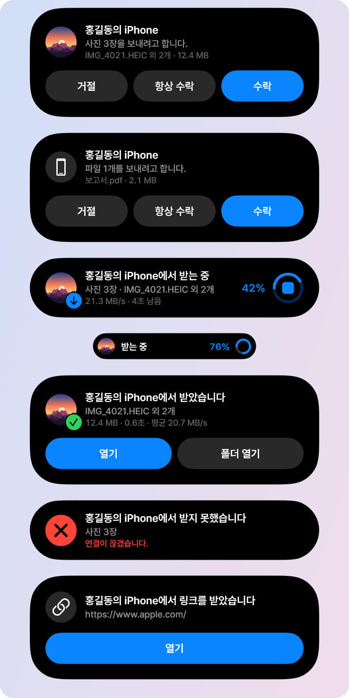
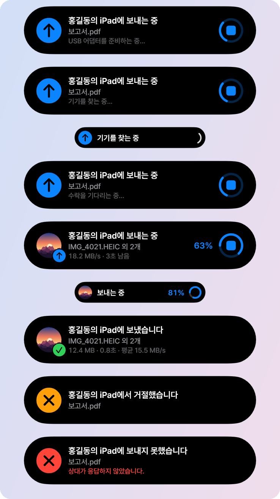
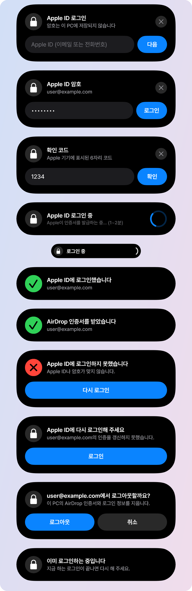
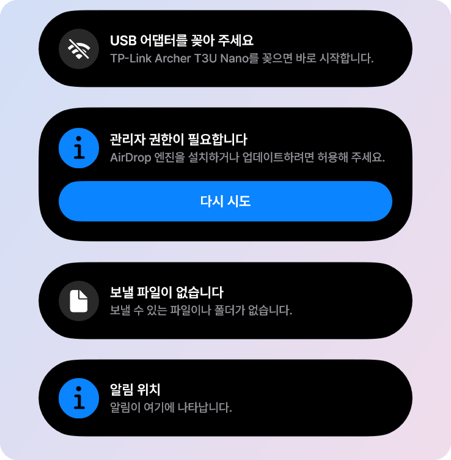
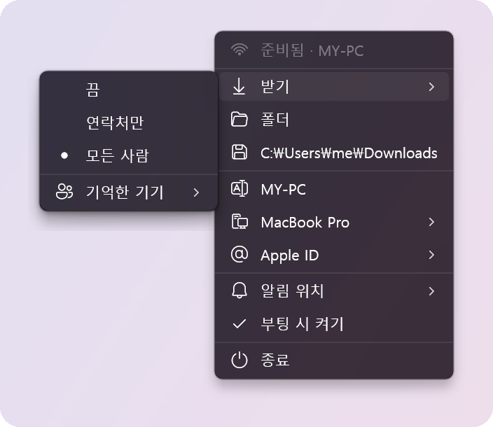
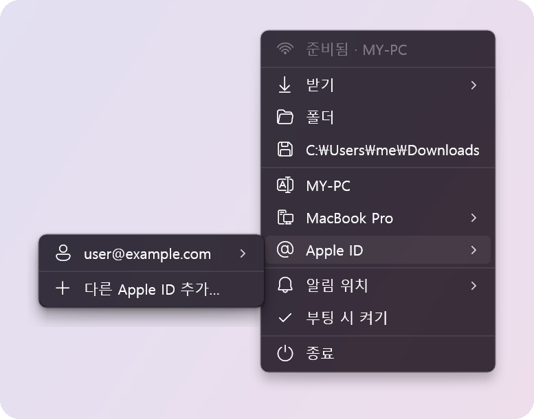
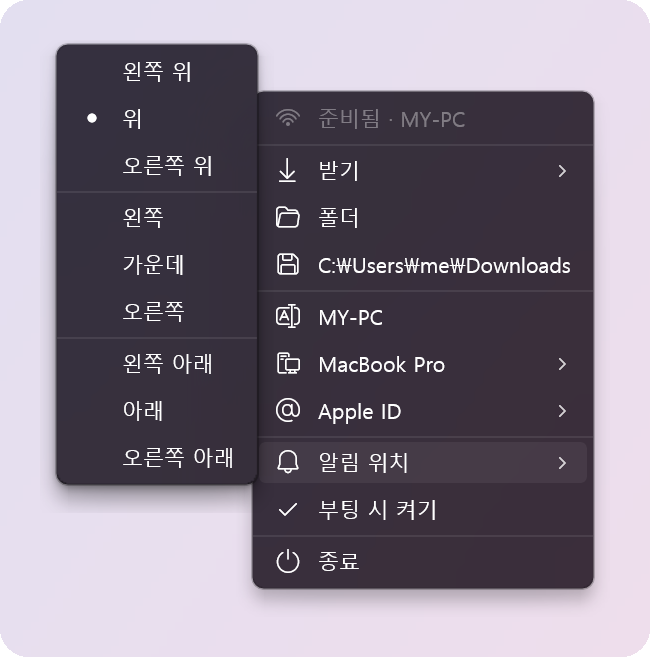
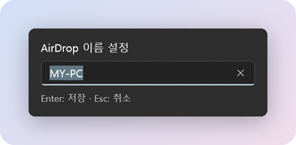
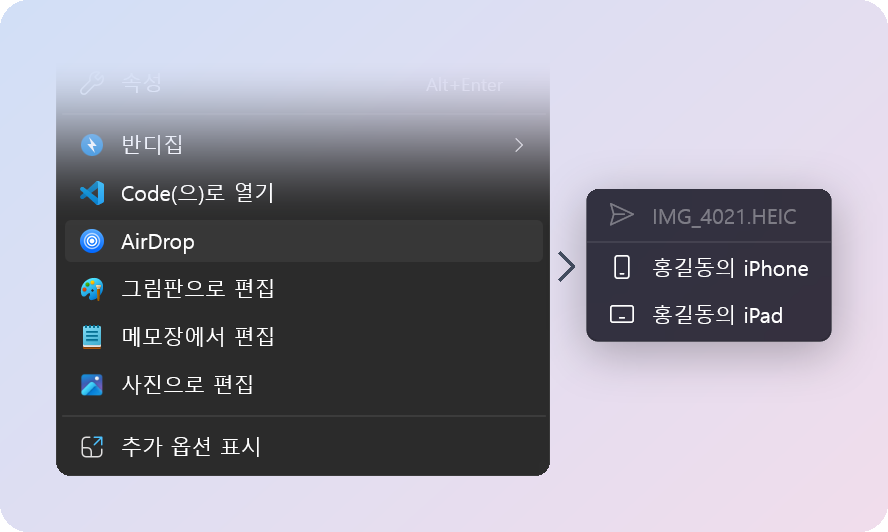
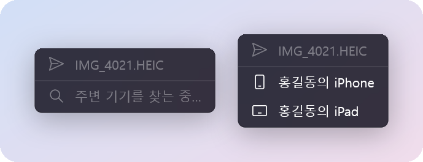

# 모든 화면

[← README로 돌아가기](../../readme/README.ko.md) · [English](../screens.md)

WirDrop에는 자체 창이 없습니다. 보여 주는 것은 모두 아일랜드의 카드, 트레이 아이콘의 메뉴, 기기
목록입니다. 아래의 이름과 파일은 견본입니다.

## 아일랜드

아일랜드는 질문이 있을 때 화면 가장자리에서 흘러나오고, 전송하는 동안 작은 알약으로 줄었다가,
결과와 함께 다시 열립니다. 뜨는 자리(가장자리, 모서리, 가운데)는 트레이 메뉴의 **알림 위치**에서
고릅니다.

### 받기

미리보기가 있는 받기 요청, 속도와 남은 시간이 보이는 전송, 작은 알약, 결과.

### 보내기

어댑터 준비, 기기 찾기, 수락 기다리기, 보내는 중, 그리고 끝난 결과.

### Apple ID

로그인은 Apple ID, 암호, 필요하면 확인 코드까지 모두 아일랜드에서 묻습니다.

### 안내

## 메뉴

### 트레이 메뉴

받기에서 누가 이 PC로 보낼 수 있는지(끔, 연락처만, 모든 사람)와 기억한 기기를 어떻게 할지 정합니다.
그 아래는 받은 파일 폴더, 이 PC의 AirDrop 이름과 iPhone에 보이는 Mac 모델, Apple ID, 아일랜드가
뜨는 자리입니다.

이름을 누르면 PC 이름을 바꾸는 작은 입력칸이 열립니다.

### 파일 탐색기에서 보내기

**AirDrop**은 파일, 폴더, 폴더 빈 곳의 오른쪽 클릭 메뉴에 있습니다. 고르면 마우스 자리에 기기
목록이 열리고, 기기를 찾는 대로 채워집니다.

