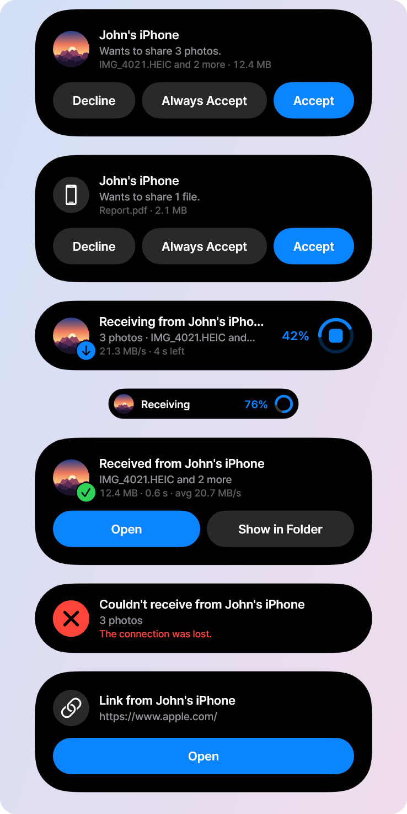
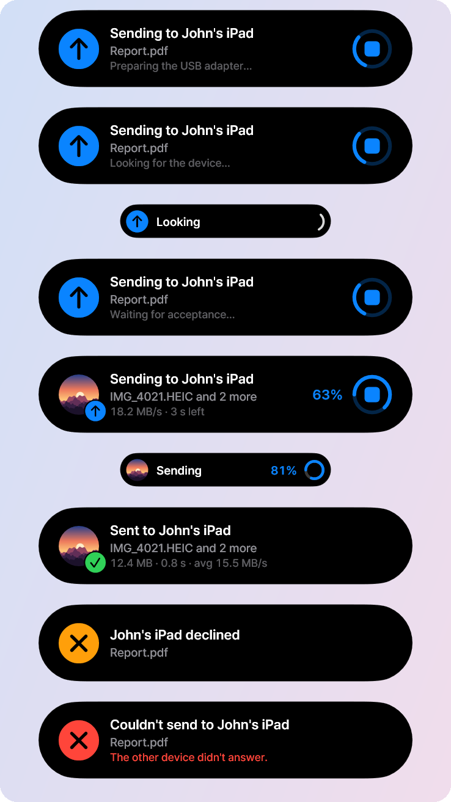
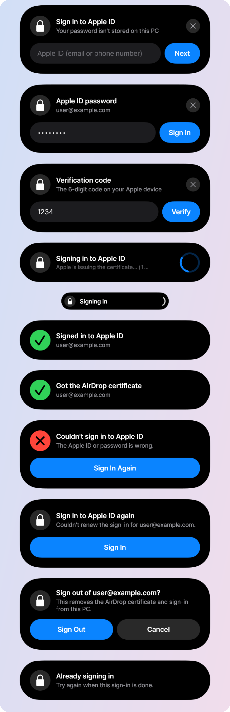
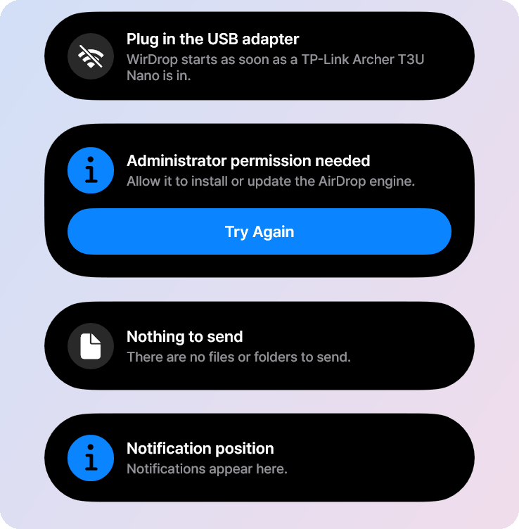
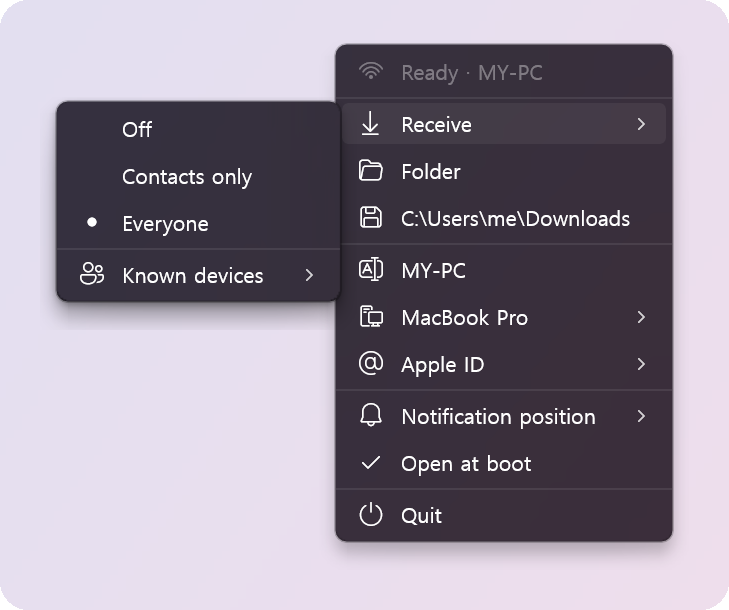
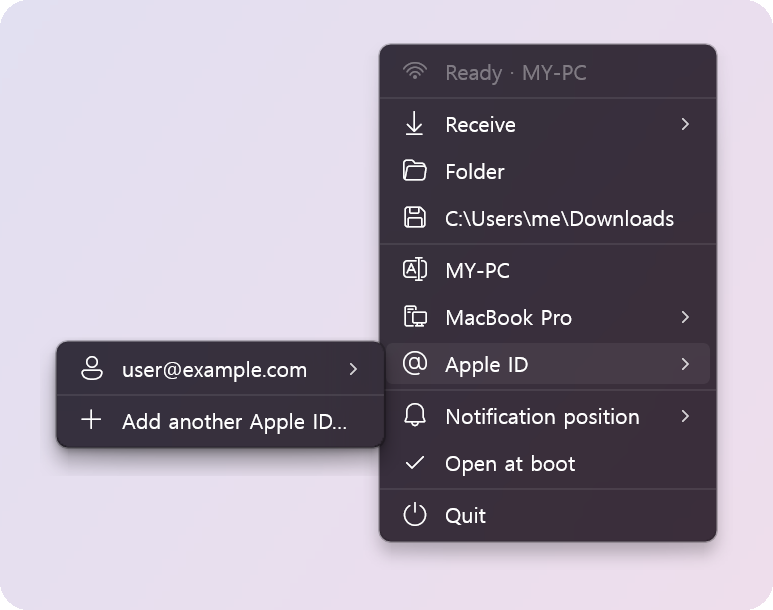
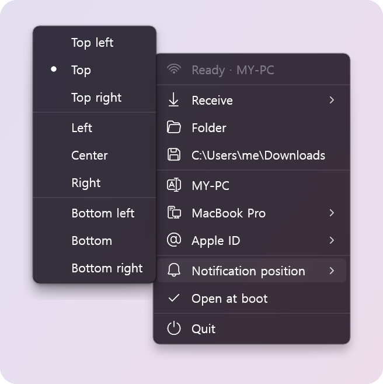
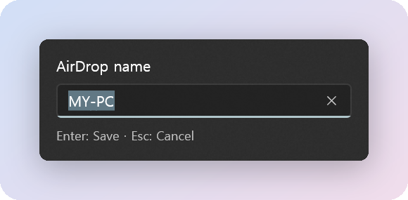
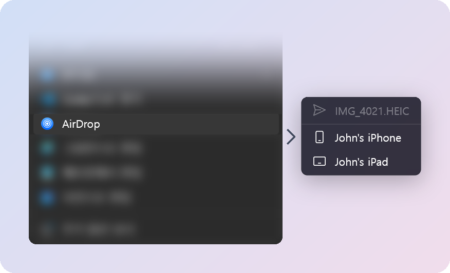
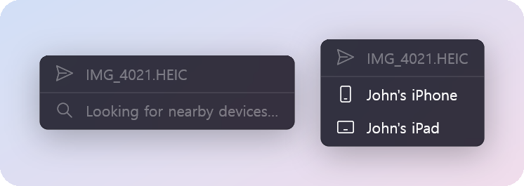

# All screens

[← Back to the README](../README.md) · [한국어](ko/screens.md)

WirDrop has no windows of its own. Everything it shows is a card on the island, the tray icon's
menu, or the device list. The names and files below are samples.

## The island

The island pours out of the screen edge for a question, shrinks to a small pill while a transfer
runs, and opens again with the result. Choose where it appears (any edge, a corner, or the middle)
under **Notification position** in the tray menu.

### Receiving

A request with its preview, the transfer with speed and time left, the small pill, and the result.

### Sending

Getting the adapter ready, looking for the device, waiting for it to accept, sending, and how it
ended.

### Apple ID

Sign-in asks for the Apple ID, the password and, if needed, a verification code, all on the island.

### Notices

## Menus

### The tray menu

Receive sets who can send to this PC (Off, Contacts only, Everyone) and how known devices are
treated. Below it are the folder for received files, this PC's AirDrop name and the Mac it shows
as on an iPhone, your Apple IDs, and where the island appears.

Clicking the name opens a small box to rename the PC:

### Sending from File Explorer

**AirDrop** is in File Explorer's right-click menu for files, folders and a folder's background.
Choosing it opens the device list at the pointer, which fills in as devices are found.

