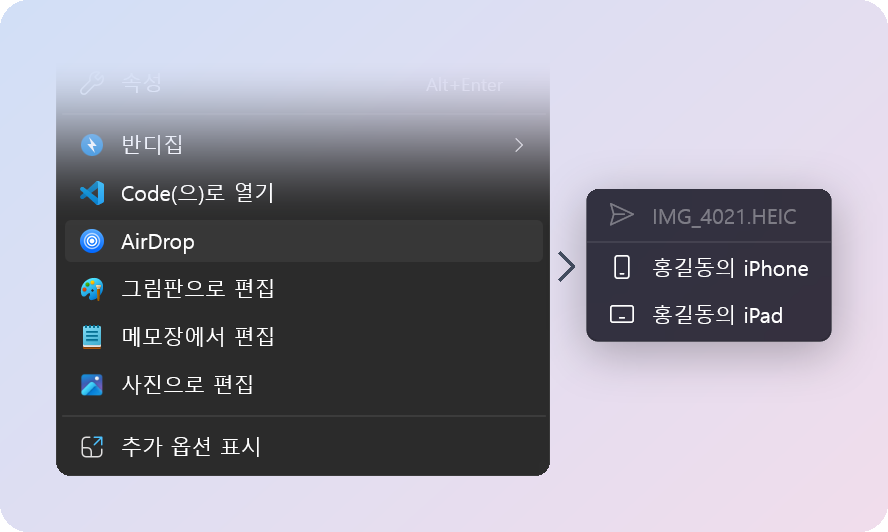
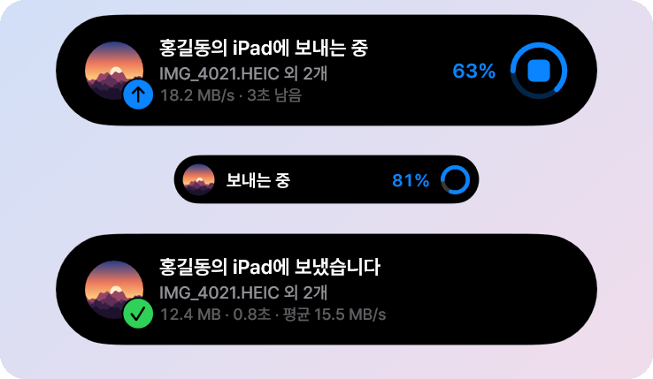
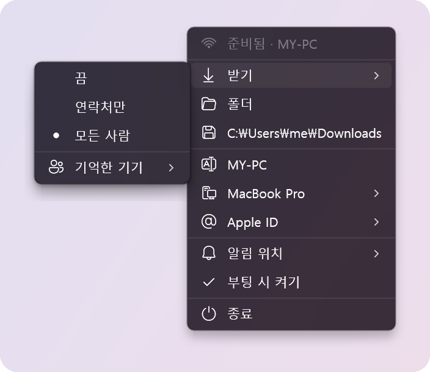

### Windows 11에서 쓰는 AirDrop

파일 탐색기에서 iPhone과 iPad로 파일을 보내고, iPhone 공유 시트에서 보낸 파일을 PC로 받습니다. 
따로 여는 창 없이 트레이 아이콘, 오른쪽 클릭 메뉴, 화면 가장자리의 Dynamic Island로 씁니다.

[English](../README.md) · **한국어**

<table>
<tr>
<td width="40%">
<h3>한 번에 받기</h3>
iPhone이 이 PC로 공유하면 화면 가장자리에서 카드가 흘러나옵니다. 내 기기와 항상 수락으로 정한
사람은 묻지 않고 바로 받습니다.
</td>
<td></td>
</tr>
<tr>
<td>
<h3>탐색기에서 보내기</h3>
파일이나 폴더를 오른쪽 클릭해 <b>AirDrop</b>을 고르고 iPhone이나 iPad를 누르세요. 기기는 찾는
대로 목록에 나타나고 사라집니다.
</td>
<td></td>
</tr>
<tr>
<td>
<h3>진행 상황 한눈에</h3>
보내고 받는 동안 속도와 남은 시간을 보여 주고, 방해되지 않게 작은 알약으로 줄어듭니다. 정지
버튼으로 언제든 멈춥니다.
</td>
<td></td>
</tr>
<tr>
<td>
<h3>메뉴 하나로 모든 설정</h3>
누가 보낼 수 있는지, 받은 파일이 갈 폴더, iPhone에 보이는 이 PC의 모습, 아일랜드가 뜨는 자리까지
트레이 아이콘에서 정합니다.
</td>
<td></td>
</tr>
<tr>
<td>
<h3>원하면 Apple ID로</h3>
아일랜드에서 로그인하면 이 PC가 내 기기로 보이고, Mac처럼 연락처만 받기를 쓸 수 있습니다.
로그인은 선택이고 암호는 저장하지 않습니다.
</td>
<td></td>
</tr>
</table>

## 필요한 것

- Bluetooth가 있는 Windows 11 PC (64비트)
- **TP-Link Archer T3U Nano** USB 무선 랜카드. 꽂혀 있는 동안 WirDrop의 AirDrop 전용 무선이
  되므로, 인터넷은 평소 쓰던 Wi-Fi로 그대로 합니다.
- AirDrop을 쓰는 iPhone이나 iPad

## 시작하기

1. [Releases](https://github.com/JungyoKim/WirDrop/releases/latest)에서 **WirDrop-Setup**을 받아
   실행합니다. 관리자 권한을 한 번 묻습니다. 아직 코드 서명이 없어 SmartScreen이 먼저 경고할 수
   있으니 **추가 정보**, **실행**을 차례로 누르세요.
2. T3U Nano를 꽂습니다. 준비되면 트레이 아이콘이 파란색이 됩니다.
3. iPhone에서 **공유**, **AirDrop**을 누르고 이 PC를 고릅니다. PC에서 보낼 때는 파일을 오른쪽
   클릭해 **AirDrop**을 고릅니다.

업데이트는 보내거나 받는 중이 아닐 때 알아서 설치됩니다.

<b>왜 USB 어댑터가 필요한가요?</b>

AirDrop은 Apple 고유의 Wi-Fi 링크인 AWDL로 동작하는데, Windows의 Wi-Fi 드라이버는 이를 지원하지
않습니다. WirDrop은 일반 앱에서 Windows 내장 WinUSB 드라이버를 거쳐 T3U Nano를 직접 다룹니다. 커널
드라이버를 설치하지 않으므로 Secure Boot도 켠 채로 씁니다. WirDrop을 제거하면 어댑터는 다시
Windows가 씁니다.

<b>얼마나 빠른가요?</b>

1 m 거리의 iPhone과 80 MB 영상을 주고받는 데 양방향 모두 약 3초(22~26 MB/s)가 걸립니다. Mac은
약 7초입니다. [동작 원리](../docs/ko/how-it-works.md#속도)를 보세요.

<b>Apple ID로 로그인해도 안전한가요?</b>

WirDrop은 Mac과 같은 방식으로 로그인하고, AirDrop 인증서를 갱신하는 세션만 Windows 계정용으로
보호해 보관합니다. 암호는 저장하지 않습니다. 로그인은 선택이며, 로그인하지 않아도 iPhone이 모든
사람으로 받기일 때는 PC가 보입니다. [Apple ID](../docs/ko/how-it-works.md#apple-id)를 보세요.

<b>키보드나 화면 읽기 프로그램으로 쓸 수 있나요?</b>

아일랜드가 떠 있을 때 **Win+Alt+A**를 누르면 버튼으로 이동합니다. Tab이나 화살표로 고르고, Enter나
Space로 누르고, Esc로 돌아갑니다. 화면 읽기 프로그램은 UI Automation으로 아일랜드를 읽습니다.

<b>여러 사람이 PC를 같이 써도 되나요?</b>

네. Mac에서 사용자마다 Apple ID가 있는 것처럼 각자 Apple ID를 더할 수 있습니다. 어느 폰에서든 PC는
한 번만 보입니다. 주인의 폰에는 내 기기로, 다른 사람에게는 이름으로 보입니다.

## 더 알아보기

- [모든 화면](../docs/ko/screens.md): WirDrop이 보여 주는 모든 카드와 메뉴
- [동작 원리](../docs/ko/how-it-works.md): AirDrop 링크, Apple ID 로그인, 속도와 한계
- [빌드하기](../docs/ko/building.md): 소스에서 빌드, 릴리스, 점검, 라이선스

> WirDrop은 Apple과 관계가 없으며 Apple의 승인을 받지 않았습니다. AirDrop은 Apple Inc.의
> 상표입니다. WirDrop은 실험 단계의 프로젝트이며, iOS와 macOS용 USB 전송 앱인 WireDrop과도 관계가
> 없습니다.

## 감사

AWDL과 AirDrop은 t4t5의 [owly](https://github.com/t4t5/owly)가 구현했고,
[omdrop-windows](https://github.com/ZyphrZero/omdrop-windows)가 처음 Windows로 옮겼습니다. 무선
드라이버는 Linux [rtw88](https://github.com/torvalds/linux/tree/master/drivers/net/wireless/realtek/rtw88)에서
옮겼고, OpenIPC의 [devourer](https://github.com/OpenIPC/devourer)가 사용자 모드 Realtek 드라이버가
가능함을 보여 주었습니다. 네트워크는 [Wintun](https://www.wintun.net)이 맡고, 트레이 메뉴는
[TranslucentTB](https://github.com/TranslucentTB/TranslucentTB)를 본보기로 삼았습니다. 이 모두는
[Open Wireless Link](https://owlink.org) 프로젝트의 AWDL과 AirDrop 분석 위에 서 있고, Apple ID
로그인은 AltServer, SideStore, pypush 등이 공개한 연구를 따릅니다.

## 라이선스

MIT입니다. [LICENSE](../LICENSE)를 보세요. 무선 드라이버에는 rtw88의 BSD-3-Clause 코드와 자체
라이선스의 Realtek 펌웨어가 함께 들어 있습니다. [crates/radio/NOTICE.md](../crates/radio/NOTICE.md)를
보세요.
